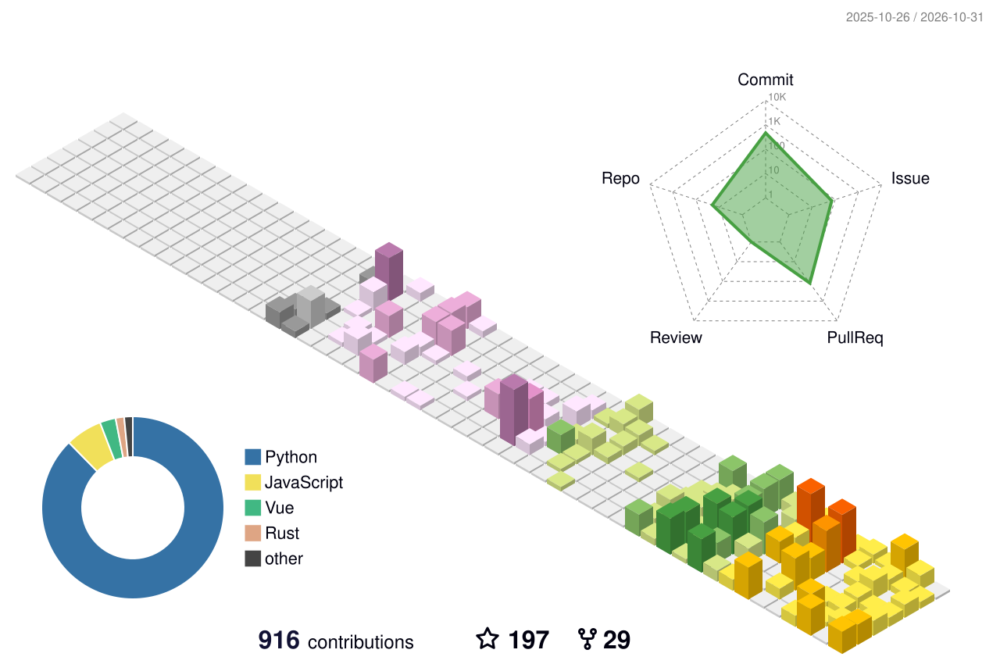

### Hi there 👋

- 🔭 I’m currently working on backend developing which is close sourced
- 🌱 I’m currently learning Stable Diffusion / LLM and other AIGC stuffs
- 👯 I’m looking to collaborate on anyone who like to explore AIGC
- 🤔 I’m looking for help with porting useful research into SD WebUI/ComfyUI
- 💬 Ask me about what ever you like to know, be polite!
- 📫 How to reach me: Send me email, but I'm not guaranteed to reply
- 😄 Pronouns: He/him, or they/them/it if you like
- ⚡ Fun fact: Like dragons, but AI not good at drawing it, so focusing on drawing pandas

<!--
**SLAPaper/SLAPaper** is a ✨ _special_ ✨ repository because its `README.md` (this file) appears on your GitHub profile.

Here are some ideas to get you started:

- 🔭 I’m currently working on ...
- 🌱 I’m currently learning ...
- 👯 I’m looking to collaborate on ...
- 🤔 I’m looking for help with ...
- 💬 Ask me about ...
- 📫 How to reach me: ...
- 😄 Pronouns: ...
- ⚡ Fun fact: ...
-->
